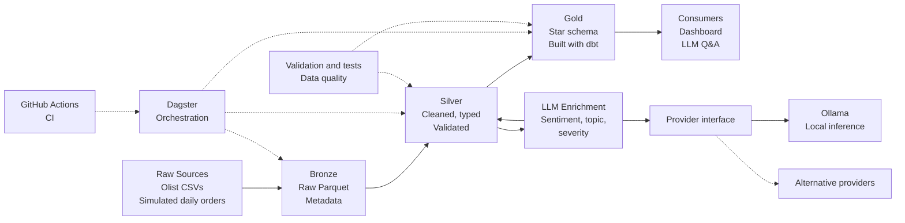

# ShopSignal Architecture

## Overview

ShopSignal is a data engineering project that transforms raw e-commerce data into validated, analytics-ready datasets. It supports product and order analysis, dashboarding, and LLM-powered question answering.

## Architecture diagram

## Data layers

### 1. Raw sources

The pipeline starts with Olist CSV datasets and simulated daily order data. The simulated data supports repeatable testing of incremental ingestion.

### 2. Bronze

Bronze stores source data in Parquet format, alongside relevant ingestion metadata. The goal is to preserve the original information and make ingestion traceable and repeatable.

### 3. Silver

Silver contains cleaned, typed, and validated data. This layer handles schema standardization, duplicate records, missing values, and data-quality rules.

### 4. LLM enrichment

LLM enrichment derives sentiment, topic, and severity from relevant records. Ollama provides local inference initially, behind a provider interface so another LLM provider can be substituted later.

Enrichment outputs should be stored with appropriate identifiers and provenance so they can be traced back to their source records. The exact persistence strategy will be defined during implementation.

### 5. Gold

Gold contains analytics-ready datasets organized as a star schema. dbt manages the transformation logic used to produce facts and dimensions from Silver data.

### 6. Consumers

Consumers include dashboards and an LLM-powered question-answering interface. These consume curated data rather than depending directly on raw source files.

## Orchestration and quality

**Dagster** orchestrates the pipeline, defining dependencies and execution boundaries between processing stages.

**Validation and tests** verify schema expectations, data quality, and transformation behavior.

**GitHub Actions** runs automated checks on code changes before they are merged.

## Design principles

- Keep Bronze, Silver, and Gold responsibilities distinct.
- Prefer reproducible ingestion and testable transformations.
- Use Parquet for portable analytical storage.
- Use DuckDB for local analytical SQL workloads.
- Manage analytical transformations with dbt.
- Keep LLM provider integration replaceable.
- Add operational complexity only when justified by requirements.